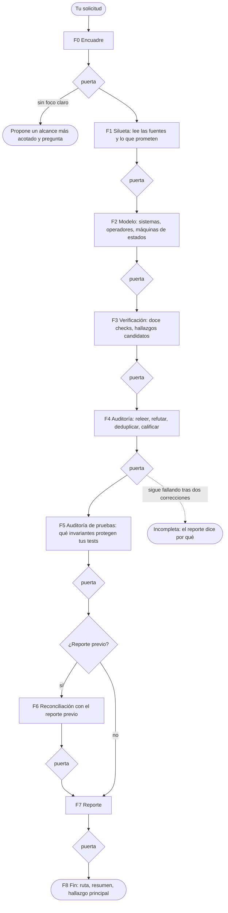

# systemic

*[Read this in English](README.md)*

**Una skill de Claude Code que audita la consistencia del software con
estado —ciclos de vida, workflows, sagas, cualquier cosa con una columna
`status`— como la Teoría General de Sistemas audita un sistema.**

Modela tu código o tu diseño como un sistema de elementos, operadores y
máquinas de estados, verifica doce propiedades de consistencia y luego lee
tus pruebas para decirte cuáles de los invariantes del sistema protegen de
verdad. Escribe un reporte en Markdown en tu disco. Cada hallazgo cita la
línea en la que se apoya, ha sobrevivido a un intento de refutarlo y lo
revisa un validador antes de que lo leas.

```
/systemic analiza el ciclo de vida de pedidos en src/orders
```

Funciona sobre código, sobre documentos de diseño, o sobre ambos.

---

## La idea

Un sistema es *un conjunto de componentes que se relacionan entre sí con un
único objetivo*. No solo las piezas — las piezas **y su capacidad de unirse**.
Dos categorías:

- **Elementos** — lo concreto: tus modelos, entidades, registros.
- **Operadores** — lo abstracto que los relaciona: tus casos de uso,
  endpoints, jobs, handlers.

Un sistema es **consistente** cuando está libre de contradicciones, y la
prueba estrella es la **clausura**: toda operación sobre los elementos del
sistema debe producir un elemento del sistema. Los enteros no son cerrados
bajo división — `1/2 = 0.5`, y `0.5` no existe ahí. Dos elementos legítimos,
un operador legítimo, y un resultado que el sistema no tiene forma de
representar.

Ese fallo tiene un análogo exacto en software, y `systemic` está construida
para encontrarlo:

```python
STATUS = {"draft", "pending_payment", "paid", "shipped", "delivered", ...}

def refund(order):
    order.status = "refund_pending"   # ← no está en STATUS. 1/2 = 0.5.
```

El pedido queda fuera de toda operación que el sistema define. No es terminal,
así que nada lo archiva. No está declarado, así que nada lo lee. Un linter ve
una asignación de string. `systemic` ve una violación de clausura y te dice
qué les hace a tus pedidos.

## Instalación

El nombre de la carpeta debe coincidir con el de la skill, así que clónala
como `systemic`:

```bash
git clone https://github.com/gdavidpb/systemic ~/.claude/skills/systemic
```

Claude Code la carga desde `~/.claude/skills/`. Para instalarla solo en un
proyecto, clónala en `.claude/skills/systemic` dentro de tu repositorio.

**Requisitos**

- [Claude Code](https://claude.com/claude-code).
- Python 3.9 o superior en la máquina donde corre Claude Code (recomendado).
  La skill lo usa para ejecutar su validador, que solo necesita la biblioteca
  estándar. Sin Python la ejecución funciona igual: las mismas comprobaciones
  se aplican a mano y el reporte lo indica.

## Inicio rápido

Pídela por su nombre o describe el problema; la skill se activa por la
intención, no por la palabra clave:

```
/systemic audita el ciclo de vida de suscripciones en billing/
```
```
¿Es consistente este diseño? docs/rental-design.md
```
```
Nuestra suite está en verde. ¿De verdad protege el ciclo de vida de pedidos?
```
```
Encuentra contradicciones entre lo que promete el README y lo que hace el código.
```
```
Revisa mi máquina de estados — creo que hay transiciones que nadie maneja.
```

Apúntala a una ruta, a un documento de diseño o a ambos. Si el módulo tiene
pruebas, las encuentra y también las audita; no hace falta que las
enumeres. Al terminar recibes en el chat la ruta del reporte, un resumen
breve, el hallazgo más grave y la brecha más grave de tus pruebas. El
reporte completo queda en `systemic-out/<alcance>.md` dentro de tu proyecto.

Si la apuntas a un repositorio grande sin foco, propone el subsistema con más
estado y espera tu respuesta antes de empezar.

## Cómo funciona una ejecución

Una ejecución pasa por nueve fases. Cada fase escribe sus resultados en disco
y un validador los revisa antes de que empiece la siguiente. Nada de lo que
dice el reporte puede venir de un paso que se saltó.



| Fase | Qué hace | Qué escribe | Qué la bloquea |
|---|---|---|---|
| F0 Encuadre | Fija qué se analiza, el modo de salida, el idioma y dónde va el reporte | `run.json` | Un alcance grande sin foco |
| F1 Silueta | Lee cada archivo del alcance, pruebas incluidas, y lista lo que prometen la documentación, los docstrings y las constantes | `sources.json` | Un archivo del alcance que no se leyó ni se excluyó con motivo |
| F2 Modelo | Describe los sistemas, operadores y máquinas de estados que el código realmente construye, y cataloga los invariantes que deben mantener | `model.json` | Una transición que ningún operador ejecuta; un estado declarado ausente del modelo; una máquina sin invariantes |
| F3 Verificación | Aplica los doce checks; cada defecto sospechado se vuelve candidato | `checks.json` | Menos de doce veredictos; "clean" sin evidencia |
| F4 Auditoría | Relee la evidencia de cada candidato, intenta refutarlo, fusiona duplicados, califica la severidad | `findings.json` | Una cita que no está en la línea indicada; un candidato sin resolver |
| F5 Auditoría de pruebas | Lee tus pruebas y decide, invariante por invariante, si alguna aserción detectaría una violación | `tests.json` | Una cobertura afirmada sin la aserción que la demuestra; una regla de idempotencia "cubierta" con una sola llamada |
| F6 Reconciliación | En una segunda ejecución, clasifica cada hallazgo anterior | `reaudit.json` | Un hallazgo anterior sin clasificar; "resolved" sin prueba de la corrección |
| F7 Reporte | Escribe el reporte a partir de los registros | `systemic-out/<alcance>.md` | Conteos o severidades distintos de los registros |
| F8 Fin | Confirma la ejecución y responde en el chat | — | — |

**Por qué puedes confiar en el resultado.** Cada hallazgo tiene que pasar
tres pruebas antes de llegarte. Su evidencia citada debe seguir en la línea
indicada cuando el validador la busca. Un intento deliberado de refutarlo
debe fallar: ¿está la guarda en un llamador, la deduplicación en un
middleware, la ambigüedad resuelta dos secciones después? Y el reporte debe
coincidir exactamente con los hallazgos registrados. El validador no puede
saber si un diagnóstico es correcto —para eso está el paso de refutación—,
pero garantiza que nada en el reporte quede sin cita, sin auditar o
descartado en silencio.

## Qué queda en tu disco

```
tu-proyecto/
└── systemic-out/
    ├── orders-module.md      ← el reporte: lee este
    └── orders-module/        ← el espacio de trabajo de la ejecución
        ├── run.json          alcance, modo, idioma, estado
        ├── sources.json      archivos leídos, con hashes, y promesas declaradas
        ├── model.json        sistemas, operadores, máquinas de estados
        ├── checks.json       doce veredictos y hallazgos candidatos
        ├── findings.json     candidatos confirmados, rechazados y fusionados
        ├── tests.json        lo que afirman tus pruebas, invariante por invariante
        ├── reaudit.json      solo en una segunda ejecución
        └── *.md / work.md    la bitácora de razonamiento de cada fase
```

- **El reporte** es el entregable. Es Markdown plano con referencias
  `archivo:línea` relativas, así que puedes commitearlo, revisarlo en un pull
  request o compartirlo.
- **El espacio de trabajo** es lo que convierte la siguiente ejecución en una
  re-auditoría, y te deja ver por qué se rechazó un candidato o de dónde salió
  una severidad. Si una ejecución se interrumpe, se retoma desde ahí.
- **Qué commitear.** Lo habitual es commitear, si acaso, el reporte, e
  ignorar el espacio de trabajo: añade `systemic-out/*/` a tu `.gitignore`.
  Borrar el espacio de trabajo es seguro; la siguiente ejecución sobre ese
  alcance se trata entonces como una primera auditoría.

## Qué verifica

Doce propiedades. Cuatro vienen directamente del marco de sistemas; el resto
aplica el mismo principio —consistencia— al software que tiene colas,
reintentos y concurrencia.

| # | Check | La pregunta que hace |
|---|---|---|
| 1 | **Clausura** | ¿Toda operación produce un estado que el sistema puede representar? |
| 2 | **Ambigüedad de operadores** | ¿Alguna operación admite dos interpretaciones razonables? |
| 3 | **Completitud de transiciones** | Para cada par (estado, operador): ¿definido, prohibido, o un **hueco**? |
| 4 | **Alcanzabilidad** | Estados que nada produce; estados de los que nada sale; transiciones muertas. |
| 5 | **Estados ilegales representables** | ¿Puede el modelo persistir una combinación que el negocio prohíbe? |
| 6 | **Invariantes y fallo parcial** | ¿Qué se rompe si el operador muere a la mitad, y quién lo repara? |
| 7 | **Idempotencia** | Clausura bajo repetición: ¿el reintento duplica el efecto? |
| 8 | **Concurrencia** | ¿Dos operadores sobre un elemento conmutan, se serializan o se pisan? |
| 9 | **Simetría** | Abrir sin cerrar, bloquear sin liberar, pausar sin reanudar. |
| 10 | **Expresión mínima** | Un valor almacenado y derivado a la vez: dos fuentes de verdad que divergen. |
| 11 | **Límites del sistema** | Requisitos fuera del conjunto representable — los hacks son la evidencia. |
| 12 | **Lazos de retroalimentación** | Reintentos que alimentan colas que alimentan reintentos, sin amortiguador. |

Cada check recibe un veredicto en cada ejecución: **findings**, **clean** (con
lo que se verificó) o **not verifiable** (con lo que faltó). El material
faltante nunca se reporta como limpio.

## ¿Tus pruebas protegen tus invariantes?

Una suite en verde te dice que sus aserciones se cumplen. No te dice cuáles
de las reglas de tu sistema defienden esas aserciones. La cobertura por
líneas tampoco: una prueba que llama a `refund()` y no comprueba nada del
estado cubre cada línea de `refund()` y no protege nada.

Por eso, después de auditar el código, `systemic` audita tus pruebas contra
el mismo modelo. Anota los invariantes que tu ciclo de vida debe mantener
—los que declara tu README y los que se deducen del modelo— y, para cada
uno, busca la aserción que fallaría si el invariante se rompiera. Lee las
pruebas; salvo que se lo pidas, nunca las ejecuta.

Los invariantes son de ocho tipos, y cada tipo solo lo detecta cierto tipo
de prueba:

| Categoría | La regla que expresa | Ejemplo | Una prueba capaz de detectar la violación |
|---|---|---|---|
| `state` | Todo estado escrito es válido | `status` es siempre uno de los valores declarados | Cualquier prueba que revise el estado tras la operación |
| `transition` | Solo ocurren las transiciones permitidas | Un pedido enviado nunca se cancela | Una prueba por cada movimiento permitido y otra por cada rechazo |
| `logical` | Los valores de negocio se mantienen coherentes | El total es siempre la suma de los ítems | Cualquier prueba que revise la relación |
| `temporal` | Lo que debe (o nunca debe) ocurrir en el tiempo | Nunca enviado antes de pagado; un ticket cerrado nunca se reabre | Pruebas que ejecutan una secuencia de operaciones |
| `repetition` | Hacerlo dos veces equivale a hacerlo una | Un webhook reenviado no cobra dos veces | Pruebas que repiten la llamada o el evento |
| `concurrency` | Operaciones simultáneas no se pisan | Dos pagos a la vez no pierden una actualización | Pruebas que fuerzan una intercalación |
| `atomicity` | Todo o nada | Si falla el courier, se deshace la reserva de stock | Pruebas que hacen fallar una dependencia a mitad de camino |
| `algebraic` | Operaciones que se deshacen o reflejan entre sí | Reanudar un pedido pausado restaura su estado anterior | Pruebas que componen operaciones y comparan resultados |

Cada invariante termina con un nivel de cobertura:

| Nivel | Significa |
|---|---|
| `asserted` | Una prueba lo afirma, con una técnica capaz de detectar la violación. El reporte cita la aserción. |
| `weak` | Las pruebas ejecutan ese código, pero nada fallaría ante una violación: el camino feliz de una guarda, un webhook entregado una sola vez, una prueba de envío en la que nada falla nunca. |
| `contradicted` | Una prueba afirma lo contrario. Pasa *gracias al* defecto, y corregir el bug la pondrá en rojo. |
| `uncovered` | Ninguna prueba lo toca. El reporte dice qué se buscó. |
| `not verifiable` | Las pruebas quedaron fuera del alcance que indicaste. |

El reporte lo resume en una tabla por ejecución (los nombres de categoría y
de nivel se quedan en inglés en todos los idiomas):

```markdown
| Categoría | Invariantes | asserted | weak | contradicted | uncovered | not verifiable |
|---|---|---|---|---|---|---|
| state | 1 | 0 | 0 | 1 | 0 | 0 |
| transition | 2 | 1 | 1 | 0 | 0 | 0 |
| repetition | 1 | 0 | 1 | 0 | 0 | 0 |
| atomicity | 1 | 0 | 1 | 0 | 0 | 0 |
| …
```

También te dice, para cada hallazgo, si tu suite lo **detecta**
(`detected`), lo deja **sin detectar** (`undetected`) o lo **consagra**
(`enshrined`): afirma como correcto el comportamiento defectuoso. Los
hallazgos consagrados van primero: son aquellos en los que corregir el
código rompe tu build. Estas brechas se reportan en su propia sección; nunca
añaden hallazgos ni cambian severidades. Si el alcance no tiene pruebas, el
reporte lo dice y cada invariante figura como `uncovered`. Si le pides que
deje fuera las pruebas, no las abre, y el reporte dice que la cobertura no se
evaluó en lugar de afirmar que algo no está probado.

## Dejar que ejecute tu código

Por defecto `systemic` es de **solo lectura**. No ejecuta tu código ni tus
pruebas: cada hallazgo se apoya en líneas que leyó y cita, y que puedes
comprobar sin fiarte de su máquina. Ejecutar código ajeno tiene efectos que
nadie pidió, y una suite en verde o en rojo responde a otra pregunta, no a
«¿qué reglas defienden estas aserciones?».

Puedes levantar esa restricción para una ejecución diciéndolo:

```
/systemic audita el ciclo de vida de órdenes en src/orders — puedes ejecutar el código y las pruebas para confirmar
```

Entonces usa la ejecución para **confirmar** lo que encontró leyendo, nunca
para sustituirlo:

- reproduce la traza de un hallazgo (los operadores, en orden, y el estado
  que dejan) antes de reportarlo;
- ejecuta la prueba que dice que detecta un defecto, para verla en rojo, y
  la que dice que lo consagra, para verla en verde;
- para un invariante que califica como `asserted`, puede romper la regla en
  una copia de tu código y comprobar que la prueba citada lo nota: lo único
  que la lectura sola no puede demostrar.

Sigue trabajando con límites: nunca modifica el proyecto que analiza (las
mutaciones se hacen en una copia, y el validador recalcula el hash de cada
fuente), no llama a la red, a bases de datos ni a servicios externos, y no
instala nada. Los scripts que ejecutó quedan en el espacio de trabajo, en
`traces/`, y el reporte dice qué se ejecutó y qué quedó solo razonado. El
permiso vale para esa ejecución: la siguiente vuelve a ser de solo lectura
salvo que lo repitas.

## Modos de salida

**`functional` es el modo por defecto; `full` añade el detalle sistémico.**
Ambos ejecutan las mismas nueve fases sobre la misma evidencia. Solo cambia el
reporte.

| Contenido | `functional` (por defecto) | `full` |
|---|---|---|
| Qué falla, cuándo y su impacto funcional | Sí, en lenguaje cotidiano | Sí, con diagnóstico sistémico |
| Evidencia, severidad, confianza y acción correctiva | Sí | Sí |
| Historial de re-auditoría y comportamiento no verificado | Sí | Sí |
| Sistemas, elementos y operadores | Solo en el espacio de trabajo | En el reporte |
| Diagramas de estados y matrices estado × operador | Solo en el espacio de trabajo | En el reporte |
| Teoría GST y el check detrás de cada hallazgo | Omitido | Incluido |
| Cobertura de los doce checks | En el espacio de trabajo; límites materiales en el reporte | Tabla completa de veredictos |
| Cobertura de invariantes por pruebas | Tabla por categoría y las brechas que importan, en palabras simples | Tabla por categoría, cada invariante y las celdas estado × operador que alcanzan tus pruebas |

Elígelo con palabras; no son flags de CLI:

```text
/systemic audita el ciclo de vida de pedidos en src/orders
/systemic audita el ciclo de vida de pedidos en src/orders, salida full
```

El primero produce `functional`, el segundo `full`. Pedir una auditoría
exhaustiva o sistémica no selecciona `full` por sí solo, y el modo de un
reporte anterior no se hereda.

## Cómo leer un hallazgo

Cada hallazgo lleva una etiqueta de honestidad:

| Etiqueta | Significa |
|---|---|
| `INCONSISTENCY` | Una contradicción **probada** con evidencia. El sistema hace X y también no-X. |
| `RISK` | Se rompe bajo una condición plausible y explícita — la condición queda escrita. |
| `AMBIGUITY` | Subespecificado. La skill **no** adivina; formula la pregunta que tu arquitecto o product owner tiene que responder. |

La severidad es `critical` / `high` / `medium` / `low`, según el daño que el
hallazgo causa de verdad. Critical exige una pérdida material grave,
irreversibilidad o corrupción persistente con impacto grave, todo sustentado;
un dominio monetario o un valor inválido no bastan. Un valor erróneo que solo se
muestra, sobre el que nada decide y que puede recalcularse, es medium. La **confianza** (high /
medium / low) es independiente de la severidad: dice qué tan sustentado está
el diagnóstico, no qué tan grave es.

Un hallazgo `functional` se ve así:

```markdown
### [high] [RISK] Un webhook de pago reintentado se cuenta dos veces
- **Qué pasa y cuándo**: cuando el proveedor reenvía el mismo evento, el pago
  se registra de nuevo y el monto se suma por segunda vez.
- **Impacto funcional**: total_paid supera lo que pagó el cliente; un pedido
  puede marcarse como pagado gracias a un duplicado.
- **Evidencia y confianza**: `webhook.py:9`, `webhook.py:10`; alta, evidencia
  directa en el código más la traza de una segunda entrega.
- **Acción recomendada**: ignorar los eventos cuyo id ya esté registrado antes
  de modificar cualquier total.
```

El resumen siempre abre con una línea de conteo como
`critical: 0 · high: 6 · medium: 2 · low: 0`. Las etiquetas, las severidades
y las palabras clave de los conteos se mantienen en inglés en todos los
idiomas, para que los reportes sigan siendo comparables y buscables con grep
entre proyectos.

## Re-auditorías

Ejecútala otra vez sobre el mismo alcance y el segundo reporte es una
re-auditoría. Cada hallazgo anterior queda clasificado y se reportan los
cuatro conteos, incluidos los ceros:

- **new** — encontrado ahora, ausente antes.
- **persisting** — la misma causa raíz, re-verificada contra el código de hoy
  en lugar de copiada.
- **resolved** — la evidencia actual muestra la corrección, o un cambio
  explícito de contrato hace inaplicable el requisito anterior. Un archivo
  movido o un número de línea obsoleto no son una corrección.
- **not verified** — no se puede confirmar ni descartar con el material del
  alcance, por ejemplo porque el comportamiento pasó a un servicio que no
  incluiste. El reporte conserva su última evidencia y dice qué haría falta
  para verificarlo. No cuenta como hallazgo actual.

Los hallazgos se emparejan por una huella (*fingerprint*) derivada de su causa
raíz, así que cambiar un título no rompe el historial. Los reportes escritos
antes de esta versión no tienen espacio de trabajo; aun así se reconocen y se
reconcilian a partir del Markdown. Cambiar el modo de salida no reinicia el
historial.

## Perfiles de ejecución y costo

El pensamiento sistémico no es gratis. Una ejecución lee cada archivo del
alcance, construye un modelo y audita cada candidato, así que tarda más y usa
más tokens que una revisión de código. La skill elige un perfil según el
tamaño del alcance:

- **quick** — unos seis archivos o menos, o un único ciclo de vida. Los
  mismos registros y puertas; el razonamiento va a una sola bitácora
  `work.md`.
- **standard** — alcances mayores. Una bitácora por fase.

Donde el entorno admite subagentes, un **verificador independiente** que
nunca vio el modelado relee la evidencia e intenta refutar los hallazgos:
todos los candidatos en `standard`, y los hallazgos calificados critical o
high en `quick`. `findings.json` registra qué hallazgos tuvieron esa segunda
mirada (`verification: independent`) y cuáles solo la de su autor (`self`).

Puedes pedir uno: "…, usa el perfil quick". Los perfiles cambian el costo,
nunca la evidencia exigida.

## Cuando una ejecución no termina

- **Te pide acotar el alcance.** El objetivo era un repositorio grande sin
  foco. Responde con el módulo o ciclo de vida que te interesa; normalmente
  propone el que tiene más estado.
- **El reporte dice que la ejecución está incompleta.** Una fase siguió
  fallando su validación tras dos correcciones; lo típico es que un archivo
  del alcance cambiara durante la ejecución, o que el material no permita
  construir un registro obligatorio. La primera sección del reporte nombra la
  fase y el motivo. Corrige la causa (deja de editar los archivos del alcance,
  añade los archivos que faltan) y vuelve a ejecutarla.
- **"Puertas verificadas manualmente".** No había Python disponible. La
  ejecución es válida, pero las comprobaciones deterministas las aplicó el
  modelo en lugar del validador. Instala Python 3.9+ para tener las
  comprobaciones automáticas.

Puedes ejecutar el validador tú mismo en cualquier momento:

```sh
python3 ~/.claude/skills/systemic/scripts/systemic_check.py all systemic-out/orders-module
```

El mismo script tiene dos ayudantes que la skill usa para no derivar a mano
lo que el validador recalcula: `hash <workspace>` imprime el hash y el número
de líneas de cada archivo del alcance, y `counts <workspace> --write` rellena
la tabla de cobertura por categoría.

## Idioma

El reporte se escribe en el idioma que pidas. Si nombras uno, gana; si no,
sigue el idioma en el que escribes. Solo las palabras clave fijas
—etiquetas, severidades, palabras de conteo y veredictos de cobertura— se
mantienen en inglés.

## Qué no es

- **No es un linter.** Lee por significado, no por patrones. No encontrará
  tus imports sin usar, y sí encontrará que tu README prohíbe lo que tu código
  permite.
- **No es un escáner de seguridad.** Usa uno; son complementarios.
- **No es para apps triviales.** Apunta a sistemas con estado real —ciclos de
  vida, workflows, sagas, cualquier cosa con una columna `status`— donde una
  inconsistencia cuesta dinero. El reporte recomienda componentes nuevos solo
  cuando el beneficio los justifica.

## Un ejemplo en modo full

Ejecutada contra un módulo de pedidos deliberadamente roto ([`evals/fixtures/orders/`](evals/fixtures/orders/)),
el reporte `full` lee la matriz así:

> De 56 celdas de la matriz estado × operador, **una columna** está bien
> cerrada (`deliver`) y **43 son huecos**. `add_item` y `apply_discount` no
> aparecen porque son ciegos al estado: mutan un pedido `delivered` igual que
> uno `draft`.
>
> La función `is_final()` existe y **ningún operador la llama**. El sistema
> declara la noción de estado final y nunca la usa.

Y cierra nombrando la pieza faltante que disuelve la mayoría de los hallazgos
de una vez:

> Cada operación escribe `order.status` directamente. Eso significa que la
> máquina de estados **no está implementada en ninguna parte** — existe como
> prosa en el README y como un conjunto de strings en `models.py`, pero ningún
> componente la hace cumplir. El equipo está cortando la madera: cada operador
> talla su propia transición a mano, y por eso cada uno puede tallarla mal de
> una manera distinta.

Esa es la diferencia con una revisión de código. Una revisión dice *falta una
guarda en la línea 30*. Esto dice *la máquina no está implementada, esta es la
pieza, y estos son los hallazgos que hace desaparecer*.

Una ejecución de ejemplo completa y validada —reporte y espacio de trabajo—
está en
[`evals/fixtures/runs/orders-valid/systemic-out/`](evals/fixtures/runs/orders-valid/systemic-out/).

## Estructura del repositorio

```
SKILL.md                      las nueve fases, reglas compartidas, etiquetas y severidad
references/
  run-contracts.md            la forma exacta de cada archivo que escribe una ejecución
  gst-framework.md            el vocabulario conceptual (se lee en F2)
  checks.md                   cómo detectar cada uno de los doce checks (se lee en F3)
  dedup.md                    un hallazgo por causa raíz: qué se agrupa y qué queda aparte (se lee en F4)
  invariants.md               categorías de invariantes y cobertura por pruebas (se lee en F2 y F5)
  reaudit.md                  clasificar los hallazgos de un reporte previo (se lee en F6, solo re-auditorías)
  output-functional.md        formato y estilo del reporte functional (por defecto)
  output-full.md              formato y estilo del reporte sistémico detallado
  run-protocol.md             reanudar, volver a una fase anterior, una puerta que no puede pasar, sin Python
  execution.md                ejecutar el código o sus pruebas, solo cuando el usuario lo permite
scripts/
  systemic_check.py           el validador de puertas y sus ayudantes (Python 3.9+, biblioteca estándar)
evals/
  evals.json                  26 evals de ejecución con aserciones; la 24 y la 25 están reservadas
  trigger-evals.json          peticiones que deben y que no deben activar la skill
  COVERAGE.md                 qué eval y qué test cubre cada comportamiento de la skill
  BASELINE.md                 los casos reservados con la skill y sin ella
  test_systemic_check.py      tests del validador: una violación de contrato por test
  test_adversarial_fixtures.py contraejemplos ejecutables de los fixtures
  fixtures/orders/            un módulo de código con defectos sembrados y una suite en verde que no los ve
  fixtures/rental-doc/        un documento de diseño con fallas sembradas
  fixtures/booking-saga/      una saga con compensaciones: fallo parcial y lazos
  fixtures/clean-ticket/      un ciclo de vida correcto con una suite sólida: el control de falsos positivos
  fixtures/guarded-elsewhere/ caminos defendidos más defectos de reembolso y recuperación
  fixtures/independent-ledgers/ causas independientes e impacto acotado
  fixtures/stock-reservations/ máquina implícita, concurrencia, un crítico justificado, pruebas con trampas
  fixtures/job-leases/        reservado, JavaScript: una cola de trabajos con leases y una suite node:test
  fixtures/approvals/         reservado: defensas en un esquema SQL y una función de transición, una deriva
  fixtures/monorepo/          un repositorio sin foco con mapa de graphify: propuesta de alcance
  fixtures/collision/         un archivo ajeno en la ruta por defecto del reporte
  fixtures/resume/            una ejecución interrumpida en F5 cuyo código cambió desde F1
  fixtures/rerun/             un reporte previo solo en Markdown (re-auditoría legacy)
  fixtures/rerun-external/    un sucesor ausente: re-auditoría no verificada
  fixtures/rerun-json/        una ejecución previa con findings.json (re-auditoría por huella)
  fixtures/runs/orders-valid/ una ejecución válida completa: el caso de referencia del validador
```

## Evals y tests

Hay dos tipos de pruebas.

**Tests deterministas**, que solo necesitan Python: 3.9 para los tests del
validador, 3.10 o superior para los de los fixtures (que usan sintaxis más
nueva), y Node.js para el único fixture en JavaScript, cuyos tests se omiten
sin él. El CI los ejecuta en cada push y en cada pull request:

```sh
PYTHONDONTWRITEBYTECODE=1 python3 -m unittest discover -s evals -p 'test_*.py' -v
```

`test_systemic_check.py` copia la ejecución de referencia, rompe un contrato
por test —un veredicto que falta, una cita desplazada de su línea, un
hallazgo critical sin su justificación, un conteo del reporte que no coincide
con los registros— y comprueba que la puerta correcta lo rechaza. También
comprueba que lo que las referencias le dicen al modelo coincide con lo que
el validador exige, y que `SKILL.md` se mantiene dentro del formato de una
skill (una descripción de 1024 caracteres como máximo, un cuerpo de 500
líneas como máximo, cada referencia nombrada y presente).
`test_adversarial_fixtures.py` ejecuta los defectos sembrados en los
fixtures, de modo que la verdad de referencia de las evals también está
probada.

**Evals de ejecución** (`evals/evals.json`): ejecutan la skill sobre un
fixture y califican el reporte y el espacio de trabajo contra aserciones
escritas. Para correr una: copia la skill a una ubicación aislada, sustituye
`<SKILL_DIR>` en el prompt por su ruta absoluta, ejecuta el prompt desde un
directorio de trabajo vacío y revisa cada aserción. Las evals 8, 9, 13, 14 y
20–23 necesitan preparación previa (un archivo sembrado, una ejecución
copiada o una máquina sin Python); la preparación está en el campo
`notes` de `evals.json`. Los casos 1–10 y 14 piden `full`; los 11–13
ejercitan la selección de modo y el historial entre modos; los 15 y 16, la
auditoría de pruebas; los 17–20 cubren concurrencia, límites del sistema, un
crítico justificado, propuestas de alcance, graphify, colisiones de nombre,
el perfil standard y pruebas excluidas; los 21–23, reanudar una ejecución
interrumpida, revisar las puertas a mano sin Python y una ejecución
incompleta; el 26, una ejecución en la que el usuario permitió ejecutar
código. [`evals/COVERAGE.md`](evals/COVERAGE.md) mapea cada
comportamiento de la skill a las evals y pruebas que lo cubren.

**Evals reservadas.** Los casos 24 y 25 (`"split": "holdout"`) existen para
medir, no para ajustar. Los demás casos se usaron mientras se escribía el
texto de la skill, así que pasarlos dice poco sobre un ciclo de vida que el
texto nunca ha visto. Cuando un caso reservado falla, corrige la instrucción
general o añade un fixture de desarrollo que muestre la misma debilidad; no
edites la skill hasta que ese caso concreto pase. El 24 es una cola de
trabajos en JavaScript con una suite `node:test`; el 25 es un módulo sano
cuyas defensas viven en un esquema SQL, con una deriva sembrada.
[`evals/BASELINE.md`](evals/BASELINE.md) registra cómo puntuaron ambos con
la skill y sin ella.

**Evals de activación** (`evals/trigger-evals.json`): son otro tipo de
prueba. Veinte peticiones realistas, de las que la mitad debe activar la
skill y la otra mitad no (una revisión de código, un test que falla,
cobertura de líneas, escribir una máquina de estados nueva). Prueban la
`description` de `SKILL.md`, que es todo lo que Claude ve cuando decide si
usar la skill. Ejecútalas con el optimizador de descripciones de la skill
`skill-creator` de Anthropic después de cambiar la descripción.

Las evals 6 y 7 son las que más importan a medida que la skill cambia. Una
herramienta que reporta problemas vale lo que vale su tasa de falsos
positivos, y todas las demás evals empujan hacia reportar más. La eval 6 mide
la contención —no encontrar nada donde no hay nada mal—. La eval 7 mide la
discriminación —rechazar cuatro trampas defendidas sin quedarse ciega ante
los defectos de al lado—.

## Contribuir

Las contribuciones más útiles son **fixtures**: un ciclo de vida con un
defecto que la skill no detecta, más la aserción que debió atraparlo. Un
check que nunca se dispara en ningún fixture es un check en el que nadie
puede confiar.

Otras contribuciones valiosas:

- **Una regla del validador** para un contrato que se pueda comprobar
  mecánicamente. Añádela a `scripts/systemic_check.py`, documéntala en
  `references/run-contracts.md` y añade un test de mutación que demuestre que
  se dispara.
- **Un test de contraejemplo** en `test_adversarial_fixtures.py` para el
  defecto sembrado de un fixture nuevo.

Mantén `README.md` y `README.es.md` sincronizados: un cambio en uno debe
llegar también al otro.

## Licencia

MIT — ver [LICENSE](LICENSE).
