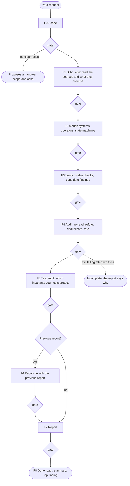

# systemic

*[Léelo en español](README.es.md)*

**A Claude Code skill that audits the consistency of software with state —
lifecycles, workflows, sagas, anything with a `status` column — the way
General Systems Theory audits a system.**

It models your code or design as a system of elements, operators and state
machines, checks twelve consistency properties, then reads your tests and
tells you which of the system's invariants they actually protect. It writes
a Markdown report on your disk. Every finding cites the line it rests on, has
survived an attempt to refute it, and is checked by a validator before you
read it.

```
/systemic analyze the order lifecycle in src/orders
```

It works on code, on design documents, or on both.

---

## The idea

A system is *a set of components that relate to each other with a single
objective*. Not just the pieces — the pieces **and their capacity to join**.
Two categories:

- **Elements** — the concrete: your models, entities, records.
- **Operators** — the abstract that relates them: your use cases, endpoints,
  jobs, handlers.

A system is **consistent** when it is free of contradictions, and the star
test is **closure**: every operation on the system's elements must produce an
element of the system. The integers are not closed under division — `1/2 =
0.5`, and `0.5` does not exist there. Two legitimate elements, one legitimate
operator, and a result the system has no way to represent.

That failure has an exact analogue in software, and `systemic` is built to
find it:

```python
STATUS = {"draft", "pending_payment", "paid", "shipped", "delivered", ...}

def refund(order):
    order.status = "refund_pending"   # ← not in STATUS. 1/2 = 0.5.
```

The order is now outside every operation the system defines. Not terminal, so
nothing archives it. Not declared, so nothing reads it. A linter sees a string
assignment. `systemic` sees a closure violation and tells you what it does to
your orders.

## Install

The folder name must match the skill name, so clone it as `systemic`:

```bash
git clone https://github.com/gdavidpb/systemic ~/.claude/skills/systemic
```

Claude Code picks it up from `~/.claude/skills/`. For a project-scoped
install, clone into `.claude/skills/systemic` inside your repository instead.

**Requirements**

- [Claude Code](https://claude.com/claude-code).
- Python 3.9 or newer on the machine where Claude Code runs (recommended).
  The skill uses it to run its validator, which needs nothing beyond the
  standard library. Without Python the run still works: the same checks are
  applied by hand and the report says so.

## Quick start

Ask for it by name, or describe the problem — the skill triggers on the
intent, not the keyword:

```
/systemic audit the subscription lifecycle in billing/
```
```
Is this design consistent? docs/rental-design.md
```
```
Our suite is green. Do our tests really protect the order lifecycle?
```
```
Find contradictions between what the README promises and what the code does.
```
```
Review my state machine — I think there are transitions nobody handles.
```

Point it at a path, a design document, or both. If the module has tests, it
finds them and audits them too; you do not need to list them. When the run
finishes you get,
in the chat, the path of the report, a short summary, the most serious
finding and the most serious gap in your tests. The full report is at `systemic-out/<scope>.md` in your project.

If you point it at a large repository with no focus, it proposes the
subsystem with the most state and waits for your answer before it starts.

## How a run works

A run goes through nine phases. Each phase writes its results to disk, and
a validator checks them before the next phase starts. Nothing the report says
can come from a step that was skipped.



| Phase | What it does | What it writes | What blocks it |
|---|---|---|---|
| F0 Scope | Settles what is analyzed, the output mode, the language and where the report goes | `run.json` | A large scope with no focus |
| F1 Silhouette | Reads every file in scope, tests included, and lists what the docs, docstrings and constants promise | `sources.json` | A file in scope that was neither read nor excluded with a reason |
| F2 Model | Describes the systems, operators and state machines the code actually builds, and catalogs the invariants they must keep | `model.json` | A transition no operator performs; a declared state missing from the model; a machine with no invariant |
| F3 Verify | Runs the twelve checks; every suspected defect becomes a candidate | `checks.json` | Fewer than twelve verdicts; "clean" without evidence |
| F4 Audit | Re-reads each candidate's evidence, tries to refute it, merges duplicates, rates severity | `findings.json` | A quote that is not at the cited line; a candidate left unresolved |
| F5 Test audit | Reads your tests and decides, invariant by invariant, whether an assertion would catch a violation | `tests.json` | A coverage claim without the assertion that proves it; an idempotency rule "covered" by a single call |
| F6 Reconcile | On a second run, classifies every earlier finding | `reaudit.json` | An earlier finding left unclassified; "resolved" without proof of the fix |
| F7 Report | Writes the report from the records | `systemic-out/<scope>.md` | Counts or severities that differ from the records |
| F8 Done | Confirms the run and replies in chat | — | — |

**Why you can trust the result.** Every finding has to pass three tests
before it reaches you. Its quoted evidence must still be at the cited line
when the validator looks. A deliberate attempt to refute it must fail: is
the guard in a caller, the dedup in a middleware, the ambiguity resolved two
sections later? And the report must match the recorded findings exactly. The
validator cannot tell whether a diagnosis is right — that is what the
refutation step is for — but it guarantees that nothing in the report is
uncited, unaudited or silently dropped.

## What lands on your disk

```
your-project/
└── systemic-out/
    ├── orders-module.md      ← the report: read this
    └── orders-module/        ← the run workspace
        ├── run.json          scope, mode, language, status
        ├── sources.json      files read, with hashes, and declared promises
        ├── model.json        systems, operators, state machines
        ├── checks.json       twelve verdicts and candidate findings
        ├── findings.json     confirmed, rejected and merged candidates
        ├── tests.json        what your tests assert, invariant by invariant
        ├── reaudit.json      only on a second run
        └── *.md / work.md    the reasoning log of each phase
```

- **The report** is the deliverable. It is plain Markdown with relative
  `file:line` references, so you can commit it, review it in a pull request
  or share it.
- **The workspace** is what makes the next run a re-audit, and lets you see
  why a candidate was rejected or where a severity came from. If a run is
  interrupted, it resumes from there.
- **Committing.** Most teams commit the report, if anything, and ignore the
  workspace: add `systemic-out/*/` to your `.gitignore`. Deleting the
  workspace is safe; the next run on that scope is then treated as a first
  audit.

## What it checks

Twelve properties. Four come straight from the systems framework; the rest
apply the same principle — consistency — to software that has queues, retries
and concurrency.

| # | Check | The question it asks |
|---|---|---|
| 1 | **Closure** | Does every operation produce a state the system can represent? |
| 2 | **Operator ambiguity** | Does any operation admit two reasonable interpretations? |
| 3 | **Transition completeness** | For every (state, operator) pair: defined, forbidden, or a **hole**? |
| 4 | **Reachability** | States nothing produces; states nothing exits; dead transitions. |
| 5 | **Illegal states representable** | Can the model persist a combination the business forbids? |
| 6 | **Invariants & partial failure** | What breaks if the operator dies halfway, and who repairs it? |
| 7 | **Idempotency** | Closure under repetition: does the retry duplicate the effect? |
| 8 | **Concurrency** | Do two operators on one element commute, serialize, or clobber? |
| 9 | **Symmetry** | Open without close, lock without release, pause without resume. |
| 10 | **Minimal expression** | A value both stored and derived: two sources of truth that drift. |
| 11 | **System limits** | Requirements outside the representable set — the hacks are the evidence. |
| 12 | **Feedback loops** | Retries feeding queues feeding retries, with no damper. |

Every check gets a verdict on every run: **findings**, **clean** (with what
was verified) or **not verifiable** (with what was missing). Missing material
is never reported as clean.

## Do your tests protect your invariants?

A green suite tells you that its assertions hold. It does not tell you which
of your system's rules those assertions defend. Line coverage does not
either: a test that calls `refund()` and checks nothing about the status
covers every line of `refund()` and protects nothing.

So after auditing the code, `systemic` audits your tests against the same
model. It writes down the invariants your lifecycle must keep — the ones your
README declares and the ones the model implies — and for each one it looks
for the assertion that would fail if the invariant broke. It reads the tests;
it never runs them.

Invariants come in eight kinds, and each kind can only be caught by a certain
kind of test:

| Category | The rule it states | Example | A test that can catch a violation |
|---|---|---|---|
| `state` | Every state written is valid | `status` is always one of the declared values | Any test that checks the state after the operation |
| `transition` | Only allowed transitions happen | A shipped order can never be canceled | One test per allowed move, one per refusal |
| `logical` | Business values stay consistent | The total is always the sum of the items | Any test that checks the relation |
| `temporal` | What must (never) happen over time | Never shipped before paid; a closed ticket never reopens | Tests that run a sequence of operations |
| `repetition` | Doing it twice equals doing it once | A redelivered webhook does not charge twice | Tests that repeat the call or the event |
| `concurrency` | Simultaneous operations do not clobber each other | Two payments at once do not lose an update | Tests that force an interleaving |
| `atomicity` | All or nothing | If the courier fails, the stock reservation is undone | Tests that make a dependency fail midway |
| `algebraic` | Operations that undo or mirror each other | Resuming a paused order restores its previous state | Tests that compose operations and compare results |

Each invariant ends with one coverage level:

| Level | Means |
|---|---|
| `asserted` | A test asserts it, with a technique that can catch a violation. The report cites the assertion. |
| `weak` | Tests run that code, but nothing would fail on a violation: the happy path of a guard, a webhook delivered once, a shipping test where nothing ever fails. |
| `contradicted` | A test asserts the opposite. It passes *because of* the defect, and fixing the bug will turn it red. |
| `uncovered` | No test touches it. The report says what was searched. |
| `not verifiable` | The tests were outside the scope you gave. |

The report summarizes this in one table per run:

```markdown
| Category | Invariants | asserted | weak | contradicted | uncovered | not verifiable |
|---|---|---|---|---|---|---|
| state | 1 | 0 | 0 | 1 | 0 | 0 |
| transition | 2 | 1 | 1 | 0 | 0 | 0 |
| repetition | 1 | 0 | 1 | 0 | 0 | 0 |
| atomicity | 1 | 0 | 1 | 0 | 0 | 0 |
| …
```

It also tells you, for every finding, whether your suite would **detect**
it, leaves it **undetected**, or **enshrines** it — asserts the buggy
behavior as correct. Enshrined findings come first: they are the ones where
fixing the code breaks your build. These gaps are reported in their own
section; they never add findings or change severities. If the scope has no
tests, the report says so and every invariant reads as uncovered. If you ask
it to leave the tests out, it does not open them, and the report says
coverage was not assessed rather than claiming anything is untested.

## Output modes

**`functional` is the default; `full` adds the systemic detail.** Both run
the same nine phases on the same evidence. Only the report differs.

| Content | `functional` (default) | `full` |
|---|---|---|
| What fails, when and its functional impact | Yes, in everyday language | Yes, with systemic diagnosis |
| Evidence, severity, confidence and corrective action | Yes | Yes |
| Re-audit history and unverified behavior | Yes | Yes |
| Systems, elements and operators | In the workspace only | In the report |
| State diagrams and state × operator matrices | In the workspace only | In the report |
| GST theory and the check behind each finding | Omitted | Included |
| Twelve-check coverage | In the workspace; material limits in the report | Full verdict table |
| Invariant coverage by tests | Category table and the gaps that matter, in plain words | Category table, every invariant, the state × operator cells your tests reach |

Choose it in plain words; these are not CLI flags:

```text
/systemic audit the order lifecycle in src/orders
/systemic audit the order lifecycle in src/orders, output full
```

The first produces `functional`, the second `full`. Asking for a thorough or
systemic audit alone does not select `full`, and a previous report's mode does
not carry over.

## Reading a finding

Every finding carries one honesty label:

| Label | Means |
|---|---|
| `INCONSISTENCY` | A contradiction **proven** with evidence. The system does X and also not-X. |
| `RISK` | Breaks under a stated, plausible condition — the condition is written down. |
| `AMBIGUITY` | Underspecified. The skill does **not** guess; it states the question your architect or product owner has to answer. |

Severity is `critical` / `high` / `medium` / `low`, rated by the damage the
finding actually causes. Critical requires supported severe material loss,
irreversibility or persistent corruption with severe impact; a monetary
domain or invalid value alone is not enough. **Confidence** (high / medium /
low) is separate from severity: it says how well the diagnosis is supported,
not how bad it is.

A `functional` finding looks like this:

```markdown
### [high] [RISK] A retried payment webhook is counted twice
- **What happens and when**: when the provider redelivers the same event,
  the payment is recorded again and the amount is added a second time.
- **Functional impact**: total_paid exceeds what the customer paid; an order
  can be marked paid on the strength of a duplicate.
- **Evidence and confidence**: `webhook.py:9`, `webhook.py:10`; high, direct
  source evidence plus a trace of a second delivery.
- **Recommended action**: ignore events whose id is already recorded before
  changing any total.
```

The summary always opens with a count line such as
`critical: 0 · high: 6 · medium: 2 · low: 0`. The labels, severities and
count keywords stay in English in every language, so reports remain
comparable and greppable across projects.

## Re-audits

Run it again on the same scope and the second report is a re-audit. Every
earlier finding is classified, and all four counts are reported, including
zeros:

- **new** — found now, absent before.
- **persisting** — the same root cause, re-verified against today's code
  rather than copied.
- **resolved** — current evidence shows the fix, or an explicit contract
  change makes the old requirement inapplicable. A moved file or a stale
  line number is not a fix.
- **not verified** — it can be neither confirmed nor ruled out with the
  material in scope, for example because the behavior moved to a service you
  did not include. The report keeps its last evidence and says what would
  verify it. It is not counted as a current finding.

Findings are matched by a fingerprint derived from their root cause, so
renaming a title does not break the history. Reports written before this
version have no workspace; they are still recognized and reconciled from the
Markdown. Changing the output mode does not reset the history.

## Run profiles and cost

Systems thinking is not free. A run reads every file in scope, builds a model
and audits each candidate, so it takes longer and uses more tokens than a
code review. The skill picks a profile from the size of the scope:

- **quick** — about six files or fewer, or a single lifecycle. The same
  records and gates; the reasoning goes into one `work.md` log.
- **standard** — larger scopes. One log per phase.

Where the environment supports subagents, an **independent verifier** that
never saw the modeling re-reads the evidence and tries to refute the
findings: every candidate in `standard`, and the findings rated critical or
high in `quick`. `findings.json` records which findings got that second look
(`verification: independent`) and which only their author's (`self`).

You can ask for one: "…, use the quick profile". Profiles change cost, never
the evidence required.

## When a run does not finish

- **It asks you to narrow the scope.** The target was a large repository
  with no focus. Answer with the module or lifecycle you care about; it
  usually proposes the one with the most state.
- **The report says the run is incomplete.** A phase kept failing its
  validator after two corrections — typically because a source file changed
  during the run, or the material cannot support a required record. The first
  section of the report names the phase and the reason. Fix the cause (stop
  editing the files in scope, add the missing files to the scope) and run it
  again.
- **"Gates checked manually."** Python was not available. The run is valid,
  but the deterministic checks were applied by the model rather than by the
  validator. Install Python 3.9+ to get the automatic checks.

You can run the validator yourself at any time:

```sh
python3 ~/.claude/skills/systemic/scripts/systemic_check.py all systemic-out/orders-module
```

The same script has two helpers the skill uses so that it never derives by
hand what the validator recomputes: `hash <workspace>` prints the hash and
line count of every file in scope, and `counts <workspace> --write` fills the
per-category coverage table.

## Language

The report is written in the language you ask for. Name one and it wins;
otherwise it follows the language you are writing in. Only the fixed keywords
— labels, severities, count keywords and coverage verdicts — stay in English.

## What it is not

- **Not a linter.** It reads for meaning, not patterns. It will not find your
  unused imports, and it will find that your README forbids what your code
  permits.
- **Not a security scanner.** Use one; they are complementary.
- **Not for trivial apps.** It targets systems with real state —
  lifecycles, workflows, sagas, anything with a `status` column — where an
  inconsistency costs money. The report recommends new components only when
  the benefit justifies them.

## A full-mode example

Run against a deliberately broken orders module ([`evals/fixtures/orders/`](evals/fixtures/orders/)),
the `full` report reads the matrix like this:

> Of 56 cells in the state × operator matrix, **one column** is properly
> closed (`deliver`) and **43 are holes**. `add_item` and `apply_discount` are
> absent because they are state-blind: they mutate a `delivered` order exactly
> as they mutate a `draft`.
>
> The function `is_final()` exists and **no operator calls it**. The system
> declares the notion of a final state and never uses it.

And it closes by naming the one missing piece that dissolves most of the
findings at once:

> Every operation writes `order.status` directly. That means the state machine
> **is implemented nowhere** — it exists as prose in the README and as a set
> of strings in `models.py`, but no component enforces it. The team is cutting
> the wood: each operator carves its own transition by hand, which is exactly
> why each one can carve it wrong in a different way.

That is the difference from a code review. A review says *a guard is missing
on line 30*. This says *the machine is unimplemented, here is the piece, and
here are the findings it makes disappear*.

A complete, validated example run — report and workspace — is in
[`evals/fixtures/runs/orders-valid/systemic-out/`](evals/fixtures/runs/orders-valid/systemic-out/).

## Repository layout

```
SKILL.md                      the nine phases, shared rules, labels and severity
references/
  run-contracts.md            the exact shape of every file a run writes
  gst-framework.md            the conceptual vocabulary (read in F2)
  checks.md                   how to detect each of the twelve checks (read in F3)
  dedup.md                    one finding per root cause: what groups, what stays separate (read in F4)
  invariants.md               invariant categories and test coverage (read in F2 and F5)
  reaudit.md                  classifying the findings of a previous report (read in F6, re-audits only)
  output-functional.md        functional report format and style (default)
  output-full.md              detailed systemic report format and style
  run-protocol.md             resuming, going back a phase, a gate that cannot pass, no Python
scripts/
  systemic_check.py           the gate validator and its helpers (Python 3.9+, standard library)
evals/
  evals.json                  25 forward evals with assertions; 24 and 25 are held out
  trigger-evals.json          queries that should and should not trigger the skill
  COVERAGE.md                 which eval and test covers each behavior of the skill
  BASELINE.md                 the held-out cases with the skill and without it
  test_systemic_check.py      validator tests: one contract violation per test
  test_adversarial_fixtures.py executable counterexamples for the fixtures
  fixtures/orders/            a code module with seeded defects and a green suite that misses them
  fixtures/rental-doc/        a design document with seeded flaws
  fixtures/booking-saga/      a compensating saga: partial failure and loops
  fixtures/clean-ticket/      a correct lifecycle with a strong suite: the false-positive control
  fixtures/guarded-elsewhere/ defended paths plus refund/recovery defects
  fixtures/independent-ledgers/ separate causes and bounded impact
  fixtures/stock-reservations/ an implicit machine, concurrency, a justified critical, tests with traps
  fixtures/job-leases/        held out, JavaScript: a job queue with leases and a node:test suite
  fixtures/approvals/         held out: defenses in a SQL schema and one transition function, one drift
  fixtures/monorepo/          an unfocused repository with a graphify map: scope proposal
  fixtures/collision/         an unrelated file at the default report path
  fixtures/resume/            a run interrupted at F5 whose source changed since F1
  fixtures/rerun/             a previous Markdown-only report (legacy re-audit)
  fixtures/rerun-external/    a missing successor: unverified re-audit
  fixtures/rerun-json/        a previous run with findings.json (fingerprint re-audit)
  fixtures/runs/orders-valid/ a complete valid run: the validator's golden case
```

## Evals and tests

There are two kinds of tests.

**Deterministic tests** need only Python: 3.9 for the validator's tests,
3.10 or newer for the fixtures' (the fixtures use newer syntax), and Node.js
for the one JavaScript fixture, whose tests are skipped without it. CI runs
them on every push and pull request:

```sh
PYTHONDONTWRITEBYTECODE=1 python3 -m unittest discover -s evals -p 'test_*.py' -v
```

`test_systemic_check.py` copies the golden run, breaks one contract per test
— a missing verdict, a quote moved off its line, a critical finding without
its justification, a report count that disagrees with the records — and
asserts that the right gate rejects it. It also checks that what the
references tell the model matches what the validator enforces, and that
`SKILL.md` stays within the skill format (a description of at most 1024
characters, a body of at most 500 lines, every reference named and present).
`test_adversarial_fixtures.py` executes the defects planted in the fixtures,
so the evals' ground truth is itself tested.

**Forward evals** (`evals/evals.json`) run the skill on a fixture and grade
the report and workspace against written assertions. To run one: copy the
skill to an isolated location, substitute its absolute path for `<SKILL_DIR>`
in the prompt, run the prompt from an empty working directory, and check each
assertion. Evals 8, 9, 13, 14 and 20–23 need setup first (a seeded file, a copied
run, or a machine without Python); the
setup is described in the `notes` field of `evals.json`. Cases 1–10 and 14
request `full`; 11–13 exercise mode selection and history across modes; 15
and 16 exercise the test audit; 17–20 cover concurrency, system limits,
a justified critical, scope proposals, graphify, name collisions, the
standard profile and excluded tests; 21–23 cover resuming an interrupted
run, checking the gates by hand without Python, and an incomplete run.
[`evals/COVERAGE.md`](evals/COVERAGE.md) maps every behavior of the skill to
the evals and tests that cover it.

**Held-out evals.** Cases 24 and 25 (`"split": "holdout"`) exist to measure,
not to tune. The other cases were used while the skill's text was written,
so passing them says little about a lifecycle the text has never seen. When
a held-out case fails, fix the general instruction or add a dev fixture that
shows the same weakness; do not edit the skill until that one case passes.
24 is a job queue in JavaScript with a `node:test` suite; 25 is a sound
module whose defenses live in a SQL schema, with one planted drift.
[`evals/BASELINE.md`](evals/BASELINE.md) records how both scored with the
skill and without it.

**Trigger evals** (`evals/trigger-evals.json`) are a different kind of
test: twenty realistic requests, half of which should make the skill
trigger and half of which should not (a code review, a failing test, line
coverage, writing a new state machine). They test the `description` in
`SKILL.md`, which is all Claude sees when it decides whether to use the
skill. Run them with the description optimizer of Anthropic's
`skill-creator` skill after changing the description.

Evals 6 and 7 matter most as the skill changes. A tool that reports problems
is only as useful as its false-positive rate, and every other eval pushes
towards reporting more. Eval 6 measures restraint — finding nothing where
nothing is wrong. Eval 7 measures discrimination — rejecting four defended
traps without going blind to the defects beside them.

## Contributing

The most useful contributions are **fixtures**: a lifecycle with a defect the
skill misses, plus the assertion that should have caught it. A check that
never fires on any fixture is a check nobody can trust.

Other good contributions:

- **A validator rule** for a contract that can be checked mechanically. Add
  it to `scripts/systemic_check.py`, document it in
  `references/run-contracts.md`, and add a mutation test that proves it
  fires.
- **A counterexample test** in `test_adversarial_fixtures.py` for a new
  fixture's planted defect.

Keep `README.md` and `README.es.md` in step: a change to one should land in
both.

## License

MIT — see [LICENSE](LICENSE).
