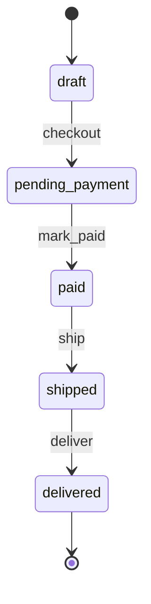

# Systemic analysis — orders module

## Executive summary

First pass over the state machine of the orders module (`models.py`,
`operations.py`): 2 findings — 1 critical (an operator writes a status outside
the declared set) and 1 high (an unguarded terminal transition). Items,
discounts, payments, the webhook and shipping were left out of this pass and
remain unverified.

## Systems identified

| System | Objective | Elements | Operators |
|---|---|---|---|
| Orders | Take an order from draft to delivered | Order, Item | checkout, mark_paid, cancel, hold, refund, ship, deliver |

## Conceptual machines

## Findings

### [critical] [INCONSISTENCY] refund() writes a status outside the system

- **Check**: 1 (closure)
- **Evidence**: `operations.py:40` — `order.status = "refund_pending"`, a
  value absent from `STATUS` (`models.py:6`)
- **Systemic diagnosis**: the operator produces a state the system cannot
  represent — the `1/2 = 0.5` problem. No operation reads, exits or archives
  `refund_pending`.
- **Recommendation**: add the state to `STATUS` and model its exits, or
  remove the operator until the refund flow is designed.

### [high] [RISK] deliver() accepts any status

- **Check**: 3 (transition completeness)
- **Evidence**: `operations.py:51` — `deliver()` writes
  `status = "delivered"` with no guard on the current status
- **Systemic diagnosis**: a hole in the (state, operator) matrix: every
  state admits `deliver`, so a draft order can be marked delivered without
  ever being paid or shipped.
- **Recommendation**: guard `deliver()` so only `shipped` orders can be
  delivered.

## Limits and not-verified

Payments, the webhook, discounts, inventory and shipping were not examined
in this pass; checks 2, 6, 7, 8, 10 and 12 remain unverified.
