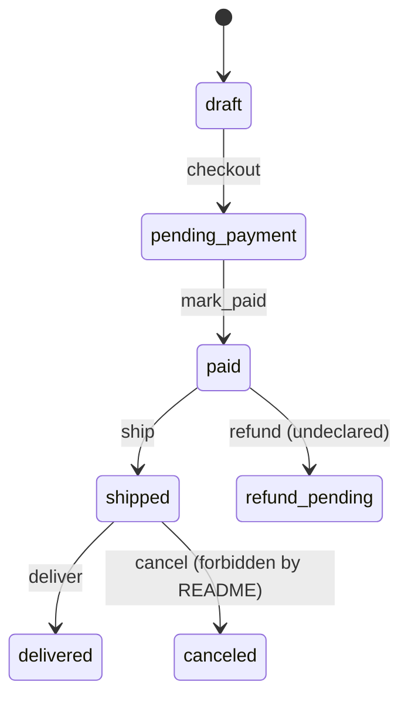

# Systemic analysis — orders module

## Executive summary

Modeled the order lifecycle of the orders module (one system, one explicit state machine).
Eight findings: critical: 0 · high: 6 · medium: 2 · low: 0. The most serious is that most
operators change the status without checking the current state.

## Systems identified

| System | Objective | Elements | Operators |
|---|---|---|---|
| Orders | Take an order from draft to delivered | Order, Item, Payment | add_item, apply_discount, checkout, mark_paid, cancel, hold, refund, ship, deliver, handle_payment_webhook |

## Conceptual machines

## Findings

### [high] [INCONSISTENCY] refund() writes a status outside the system

- **Check**: 1
- **Evidence**: `operations.py:40` — `order.status = "refund_pending"`; `models.py:6` — `STATUS = {`
- **Systemic diagnosis**: refund assigns the literal 'refund_pending', which STATUS does not declare.
- **Impact and confidence**: A refunded order holds a status no operation reads, exits or archives. Confidence high.
- **Recommendation**: Declare refund_pending with its exits, or route refunds through a declared state.

### [medium] [INCONSISTENCY] in_review is declared but nothing produces it

- **Check**: 4
- **Evidence**: `models.py:9` — `"in_review",`; `operations.py:27` — `order.status = "paid"`
- **Systemic diagnosis**: No operator writes in_review; mark_paid skips the anti-fraud state.
- **Impact and confidence**: Every payment bypasses the declared anti-fraud review. Confidence high.
- **Recommendation**: Add the operator that moves pending_payment to in_review and make mark_paid require it.

### [high] [INCONSISTENCY] Operators change status without checking the current state

- **Check**: 3
- **Evidence**: `operations.py:31` — `order.status = "canceled"`; `README.md:11` — `A shipped order can`
- **Systemic diagnosis**: Only deliver guards its source state; every other status write ignores the current state.
- **Impact and confidence**: cancel turns a shipped order into canceled, which the README forbids. Confidence high.
- **Recommendation**: Introduce a single transition function with a declared transition table.

### [high] [INCONSISTENCY] Paused orders can never resume

- **Check**: 9
- **Evidence**: `operations.py:35` — `order.held_from = order.status`
- **Systemic diagnosis**: hold has no inverse operator that restores held_from.
- **Impact and confidence**: An order put on hold stays on_hold permanently. Confidence high.
- **Recommendation**: Add resume() that restores held_from and clears it.

### [medium] [AMBIGUITY] The discount unit depends on the value

- **Check**: 2
- **Evidence**: `operations.py:14` — `if value <= 1:`; `README.md:24` — `Discounts are expressed as a **percentage** (0-100)`
- **Systemic diagnosis**: apply_discount switches between fraction and amount at value 1, contradicting the percentage rule.
- **Impact and confidence**: A discount of 1 removes the whole total while 2 subtracts two currency units. Confidence high.
- **Recommendation**: Decide the unit, accept only that unit, and validate the range.

### [high] [INCONSISTENCY] The stored total drifts from the items

- **Check**: 10
- **Evidence**: `operations.py:15` — `order.total = order.total * (1 - value)`; `models.py:47` — `return sum(i.qty * i.price for i in order.items)`
- **Systemic diagnosis**: total is materialized and also derivable from items, and writers update only one side.
- **Impact and confidence**: Adding an item after checkout leaves total lower than the sum of the items. Confidence high.
- **Recommendation**: Derive the total from items and store the discount separately.

### [high] [RISK] A retried payment webhook is counted twice

- **Check**: 7
- **Evidence**: `webhook.py:9` — `order.payments.append(Payment(amount=event["amount"], event_id=event["id"]))`
- **Systemic diagnosis**: The handler appends and adds the amount without checking the event id.
- **Impact and confidence**: Delivering the same event twice doubles total_paid. Confidence high.
- **Recommendation**: Ignore events whose id is already recorded before changing totals.

### [high] [RISK] A courier failure leaves inventory reserved

- **Check**: 6
- **Evidence**: `operations.py:44` — `inventory.reserve(order.items)`; `operations.py:45` — `# TODO: wrap in a transaction`
- **Systemic diagnosis**: ship performs two side effects without a transaction or compensation.
- **Impact and confidence**: If courier.notify raises, inventory stays reserved and the order is not shipped. Confidence high.
- **Recommendation**: Reserve and notify atomically, or release the reservation when notify fails.

## Rejected candidates

| Candidate | Refuting evidence |
|---|---|
| deliver writes delivered from any state | `operations.py:52` raises unless the order is shipped |

## Limits and not-verified

| # | Check | Verdict | Evidence / why |
|---|---|---|---|
| 1 | Closure | findings | C-1, C-10 |
| 2 | Operator ambiguity | findings | C-5 |
| 3 | Transition completeness | findings | C-3 |
| 4 | Reachability | findings | C-2, C-9 |
| 5 | Illegal states representable | not verifiable | There is no persistence schema in scope, so which field combinations the store accepts cannot be established |
| 6 | Invariants and partial failure | findings | C-8 |
| 7 | Idempotency | findings | C-7 |
| 8 | Concurrency | not verifiable | Order is an in-memory dataclass; no persistence or locking layer is in scope |
| 9 | Symmetry | findings | C-4 |
| 10 | Minimal expression | findings | C-6 |
| 11 | System limits | not verifiable | The material states no pending requirement to compare against the representable set |
| 12 | Feedback loops | clean | No retry, queue or timeout cycle exists in scope: the webhook calls mark_paid once and nothing re-enqueues work |
